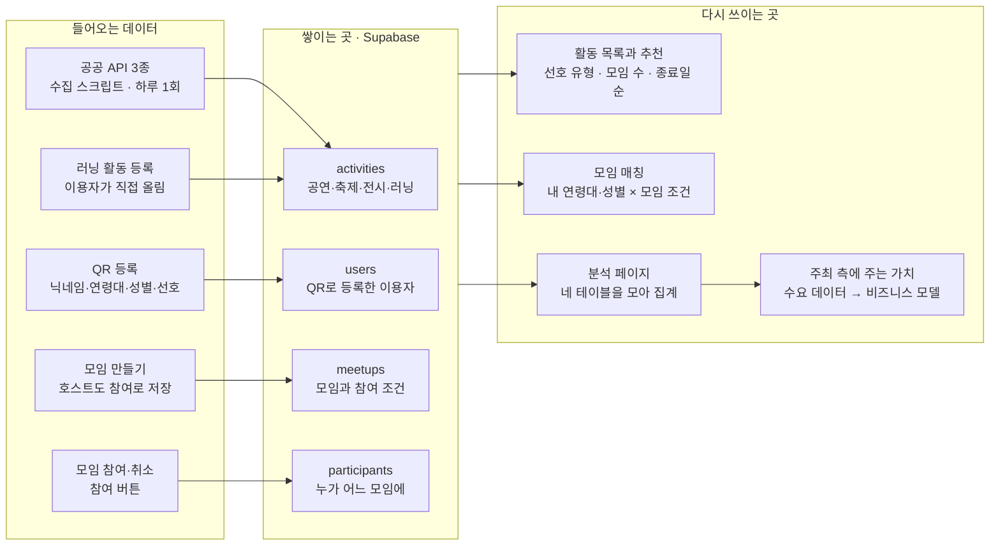

# 같이 갈래? 기획 요구사항 초안

2026-10-10 · 찬휘 · 9조 서비스 기획 · v0.1

> 이 파일은 Claude 문서 「같이 갈래? 기획 요구사항 초안」(v0.1)을 2026-10-11에 옮긴 사본이에요.
> 본문은 원문 그대로이고, 바로 아래 '지금 코드와 다른 점'만 옮기면서 덧붙였어요.

## 지금 코드와 다른 점 (2026-10-11 기준, 옮기면서 덧붙임)

이 기획안은 팀 검토 중인 초안이고, 저장소 코드는 이와 따로 먼저 만들어져서 다른 곳이 있어요. 어느 쪽으로 맞출지는 팀이 정해요. 그 전까지 Claude Code는 한쪽에 맞춰 임의로 고치지 않고 먼저 물어봐요.

| 항목 | 기획안 | 지금 코드 |
| --- | --- | --- |
| 지역 | 서울 25개 구만 저장 | 시드 데이터와 지도는 KAIST(대전) 기준. 공공 API 수집은 서울·대전 둘 다 받음 |
| 테이블 | 4개. likes, 찬반 응답, 선호 지역 없음. 더미 여부 칸 있음 | 6개(likes, messages 포함). participants.vote, users.preferred_regions 있음. 더미 여부 칸 없음 (가입 시각은 created_at) |
| 화면 | 6개 | 지도, 모임톡(채팅), 라이브 보드, 발표용 QR 화면이 더 있고 좋아요 버튼도 있음 |
| QR 등록 항목 | 닉네임·연령대·성별·선호 유형(1개) 모두 필수. 연령대 20대~50대 이상 | 닉네임만 필수. 연령대 10대·20대·30대·40대+, 성별에 '기타' 있음. 선호 유형은 쉼표로 여러 개, 선호 지역 입력 있음 |
| 출처 값 | 한국관광공사, KOPIS, 한국문화정보원, 사용자 | 공공 API는 'KOPIS'·'한국관광공사'로 저장. 사용자가 올린 활동은 'user', 시드는 'user'·'API' |
| 날짜 필터 | 오늘·이번 주말·다음 주, 기간 겹침 | API(`GET /activities`의 date_from·date_to)는 기간 겹침으로 거름. 화면에는 날짜 필터가 아직 없음 |
| 활동 정렬(추천) | 선호 유형 → 모집 중 모임 수 → 종료일 | 진행 중이거나 곧 시작하는 것 먼저, 끝난 것은 맨 뒤. 개인화 없음 |
| 모임 목록 | 지난 모임은 숨기고, 내 조건에 맞는 모임만 보여줌 | 활동의 모임을 모두 보여줌. 참여할 때만 정원·연령대·성별을 확인하고, 둘 중 한쪽 값이 비어 있으면 통과 |
| 모임 규칙 | 정원 2~10명, 집결 시간은 활동 기간 안, 참여 취소 가능 | 정원·집결 시간 검사 없음, 참여 취소 API 없음. 호스트 자동 참여는 같음 |
| 분석 | '전체 / 오늘 QR 참여자만' 보기 전환 | 전환 없음 (더미 여부 칸이 없음) |
| KOPIS 안내 문구 | 상세 화면에 집계기간·집계대상·발권 기준 안내 | 설명 끝에 출처만 붙임. 안내 문구는 아직 없음 |

기획과 맞춰 둔 것: activities의 시작일·종료일·원본 ID·원본 링크는 공공 API 수집 작업에서 `starts_at`·`ends_at`·`external_id`·`source_url`로 들어갔어요. '시간 안내'는 따로 칸 없이 설명(`description`)에 들어가요.

## 먼저 읽어 주세요

이 문서의 안으로 MVP 범위, 이용자 입력 항목, 매칭 규칙, 화면 구성을 확정하려고 해요. 이견이 있으면 10월 11일 낮 12시까지 단톡방에 남겨 주세요. 의견이 없으면 이대로 확정하고 테이블 생성부터 시작해요.

| 담당 | 먼저 볼 곳 | 이유 |
| --- | --- | --- |
| 동주 (백엔드·QR) | 매칭 규칙, 모임 규칙, 테이블에 필요한 칸 | 테이블과 API를 이 기준으로 만들어요 |
| 영선 (외부 API) | 모두가 똑같이 쓰는 값, 테이블에 필요한 칸 | API 분류와 주소를 이 값에 맞춰야 매칭이 돼요 |
| 지호 (프론트·배포) | 화면별 요구사항, 모두가 똑같이 쓰는 값 | 화면과 버튼이 이 구성을 따라요 |
| 연경 (발표) | 이렇게 쓰는 서비스예요, 발표 시연 흐름 | 발표 1번(기획 시나리오)과 4번(QR 시연)의 재료예요 |

기준 자료는 9/30 피칭 자료와 목업, 10/8 회의, 10/9 진행 현황 페이지예요. 엔드포인트 이름, 컬럼 이름과 타입처럼 구현에 가까운 것은 각 담당이 정해요.

## 한눈에 보기

핵심 결정은 일곱 가지예요.

1. MVP는 피칭의 기본 흐름(활동 탐색 → 모임 개설·참여 → 분석)에 QR 등록과 단순 조건 매칭을 더한 것까지예요.
2. 좋아요 → 모임 제안 → 찬반 흐름은 이번에 만들지 않고, 발표에서 확장 방향으로 소개해요.
3. QR로는 닉네임, 연령대, 성별, 선호 유형 네 가지만 받아요. 로그인은 없어요.
4. 유형·연령대·성별·지역 표기는 이 문서의 값 목록 하나로 통일해요.
5. 매칭은 '거르기'(조건에 안 맞는 것 빼기)와 '정렬'(무엇을 위에 보여줄지)로 나눠 정해요. 이 정렬 규칙이 곧 추천이에요.
6. 테이블은 activities, users, meetups, participants 네 개예요. likes 테이블은 만들지 않아요.
7. 인기 활동은 참여 인원으로 판단해요.

## 이렇게 쓰는 서비스예요

「같이 갈래?」는 "이번 주말에 뭐 하지?"에서 시작해 "이거 같이 갈래?"로 끝나요. 참여하는 사람과 모임을 여는 사람, 두 이야기로 흐름을 정리했어요.

### 이야기 1. 같이 갈 사람을 찾는 서연

서연(32세, 직장인)은 금요일 밤까지 주말 계획이 없어요. 「같이 갈래?」에 처음 들어와 닉네임을 정하고 30대, 여, 선호 유형 '전시'를 골라요.

활동 목록에서 '이번 주말 · 마포구 · 전체'를 고르자 전시가 위로 올라와요. 그중 '모임 모집 중' 표시가 붙은 사진전이 눈에 띄어요.

사진전 상세에는 서연이 참여할 수 있는 모임 두 개만 보여요. 그중 토요일 오전 11시에 모이는 30대 여성 3인 모임에 참여해요. 토요일, 서연은 처음 만난 사람들과 사진전을 봐요.

### 이야기 2. 러닝 모임을 여는 준호

준호(28세, 대학원생)는 일요일 아침에 한강을 같이 달릴 사람을 찾아요. 러닝은 공공 API에 없는 활동이라 '일요일 오전 7시 · 망원한강공원 · 마포구 · 무료'로 직접 등록해요.

등록을 마치면 바로 모임 만들기로 이어져요. 정원 6명, 연령대 조건 '20대', 성별 조건 '무관'으로 모임을 열어요.

이 모임은 20대 이용자에게만 보여요. 준호는 개설과 동시에 첫 참여자가 돼요.

### 데이터는 이렇게 흘러요

*데이터 흐름 · 들어오는 곳 5개, 테이블 4개, 쓰이는 곳 4개. 들어온 데이터는 네 테이블에 쌓였다가 추천·매칭·분석으로 다시 쓰여요.*

공공 데이터로 찾고, 이용자 데이터로 맞추고, 쌓인 참여 데이터로 분석해요. 그 분석이 주최 측에 줄 가치가 되므로, 발표 1번 '데이터 활용 기획 시나리오'는 이 순서를 그대로 따라가면 돼요.

## 만드는 것과 미루는 것

이번에는 피칭의 기본 흐름에 QR 등록과 단순 조건 매칭까지 만들어요. 발표까지 11일이라 '필수'를 먼저 끝내고 '권장'은 그다음에 만들어요.

| 기능 | 결정 | 이유 |
| --- | --- | --- |
| 활동 탐색 (날짜·지역·유형 필터) | 필수 | 서비스의 출발점이에요 |
| 모임 개설·참여·취소 | 필수 | '같이 갈래?'의 핵심이에요 |
| QR 이용자 등록 | 필수 | 발표 현장 시연의 입구예요 |
| 조건 매칭 (연령대·성별) | 필수 | 어차피 받는 정보에 조건 하나를 더 거는 정도라 비용이 작아요 |
| 추천 (정렬 규칙) | 필수 | 별도 기능이 아니라 목록을 보여주는 순서예요 |
| 분석 페이지 | 필수 | 교수님 필수 페이지예요 |
| 활동 카드의 '모임 모집 중' 표시 | 권장 | 같이 갈 사람이 있는 활동이 한눈에 보여요 |
| 러닝 활동 직접 등록 | 권장 | 시간이 부족하면 러닝 활동은 더미 데이터로 채워요 |
| 좋아요 → 모임 제안 → 찬반 | 미룸 | 제안·투표 상태 처리가 새로 필요하고, 참여·개설 흐름과 기능이 겹쳐요 |
| 좋아요 버튼만 따로 | 미룸 | 인기 판단은 참여 인원으로 충분해요. 시간이 남으면 추가해요 |
| 선호 지역 수집 | 미룸 | 지역은 검색할 때마다 골라요 |
| 로그인 | 미룸 | 시연에는 브라우저 저장으로 충분해요 |
| 모임 수정·삭제 | 미룸 | 시연 흐름에 없어요 |

의견이 다른 항목은 그 줄에 댓글을 달아 주세요.

## 이용자에게 받는 정보

QR 등록에서는 네 가지만 받아요. 닉네임 말고는 모두 버튼으로 골라서, 휴대폰으로 20초 안에 끝나는 게 목표예요.

| 항목 | 입력 방식 | 선택지 | 쓰는 곳 |
| --- | --- | --- | --- |
| 닉네임 | 직접 입력, 2~10자 | 자유 (실명 대신) | 모임 참여자 목록에 표시 |
| 연령대 | 버튼 하나 | 20대 · 30대 · 40대 · 50대 이상 | 조건 매칭, 이용자 통계 |
| 성별 | 버튼 하나 | 남 · 여 · 선택 안 함 | 조건 매칭, 이용자 통계 |
| 선호 유형 | 버튼 하나 | 공연 · 축제 · 전시 · 러닝 | 추천 정렬, 연령대별 선호 분석 |

네 항목 모두 필수예요. 성별은 '선택 안 함'도 답으로 인정해요.

### 받지 않는 것

- 실명, 연락처: 시연에 필요 없고 개인정보 부담만 커져요.
- 정확한 나이: 연령대로 충분해요.
- 선호 지역: 지역은 검색할 때마다 고르고, 25개 구 목록은 휴대폰 입력 부담에 비해 쓸 데가 적어요.
- 선호 유형 여러 개: 연령대별 선호를 셈 때 한 사람이 여러 번 세어져서 해석이 꼬여요.

### 등록 화면 안내 문구

> 발표 시연용으로만 사용하고, 발표가 끝나면 삭제해요. 실명 대신 닉네임을 써 주세요.

### 시스템이 채우는 값

- 이용자 번호(user_id): 등록하면 서버가 만들어 돌려줘요.
- 가입 시각: '오늘 QR로 들어온 사람'을 따로 볼 때 써요.
- 더미 여부: 미리 넣은 더미는 '예', QR로 들어온 사람은 '아니오'예요. 분석 페이지에서 둘을 나눠 볼 수 있어요.

### 로그인 없이 '나'를 알아보는 방법

- 등록하면 받은 이용자 번호를 브라우저에 저장해요.
- 이후 목록 조회, 참여, 모임 개설 요청에 이 번호를 같이 보내요.
- 같은 브라우저로 다시 들어오면 등록 화면을 건너뛰어요. 브라우저 기록을 지우거나 기기를 바꾸면 다시 등록해야 해요.

## 모두가 똑같이 쓰는 값

아래 값은 DB, API 수집, 화면 버튼에 글자 하나 다르지 않게 똑같이 써요. '마포'와 '마포구'처럼 조금만 달라도 조회에 안 잡혀요.

| 항목 | 값 | 메모 |
| --- | --- | --- |
| 유형 | 공연, 축제, 전시, 러닝 | API 분류는 수집할 때 이 넷 중 하나로 바꿔 저장해요 |
| 연령대 | 20대, 30대, 40대, 50대 이상 | 정확한 나이는 받지 않아요 |
| 성별 | 남, 여, 선택 안 함 | '선택 안 함'은 성별 조건이 '무관'인 모임만 볼 수 있어요 |
| 모임 연령대 조건 | 무관, 20대, 30대, 40대, 50대 이상 | 기본값은 무관, 하나만 골라요 |
| 모임 성별 조건 | 무관, 남, 여 | 기본값은 무관이에요 |
| 출처 | 한국관광공사, KOPIS, 한국문화정보원, 사용자 | 분석의 출처별 건수에 써요 |
| 지역 | 서울 25개 구, 'OO구' 형식 | 아래 목록 그대로 써요 |

### 지역 목록 (가나다순)

강남구, 강동구, 강북구, 강서구, 관악구, 광진구, 구로구, 금천구, 노원구, 도봉구, 동대문구, 동작구, 마포구, 서대문구, 서초구, 성동구, 성북구, 송파구, 양천구, 영등포구, 용산구, 은평구, 종로구, 중구, 중랑구

서울 밖이거나 주소에서 구를 알 수 없는 활동은 저장하지 않아요.

### 날짜 필터 (한국 시간 기준)

| 필터 | 범위 | 발표일(10/21, 수)에 누르면 |
| --- | --- | --- |
| 오늘 | 오늘 하루 | 10/21 |
| 이번 주말 | 이번 주 토요일과 일요일. 토요일엔 토·일, 일요일엔 그날만 | 10/24 ~ 10/25 |
| 다음 주 | 다음 주 월요일 ~ 일요일 | 10/26 ~ 11/1 |

- 기간이 있는 활동(전시, 축제, 장기 공연)은 기간이 필터 범위와 하루라도 겹치면 보여요. 예를 들어 10/1~11/30 전시는 세 필터 모두에 나와요.
- 그래서 활동에는 시작일과 종료일 두 칸이 필요해요. 하루짜리 활동은 둘을 같은 날로 넣어요.
- 발표 날 필터가 비지 않으려면 활동 데이터가 최소 11/1까지는 있어야 해요. 적재 범위는 영선이 정하되, 이 날짜는 꼭 포함해 주세요.

## 매칭 규칙

매칭은 '거르기'와 '정렬' 두 단계예요. 거르기는 조건에 안 맞는 것을 빼고, 정렬은 남은 것 중 무엇을 위에 보여줄지 정해요.

거르는 조건은 한꺼번에 적용되기 때문에 순서가 결과를 바꾸지 않아요. 순서가 중요한 건 정렬 쪽이에요.

### 활동 목록

**거르기**: 아래를 모두 만족하는 활동만 남겨요.

- 기간이 날짜 필터 범위와 겹침
- 지역이 고른 구와 같음 ('전체'면 통과)
- 유형이 고른 유형과 같음 ('전체'면 통과)

**정렬**: 1번부터 차례로 비교하고, 같으면 다음 기준으로 넘어가요.

1. 내 선호 유형과 같은 활동 먼저. 유형 필터가 '전체'일 때 효과가 보여요.
2. 모집 중인 모임이 많은 활동 먼저 (권장). 모집 중은 집결 시간 전이고 자리가 남은 모임이에요. 개수는 내 조건과 상관없이 세서 구현을 단순하게 해요.
3. 종료일이 빠른 활동 먼저. 곧 끝나서 놓치기 쉬운 것부터 보여줘요.

첫 화면 기본값은 '이번 주말 · 전체 · 전체'예요. 피칭 문구 "이번 주말에 뭐 하지?"와 맞춘 거예요.

### 모임 목록 (활동 상세 안)

**거르기**: 집결 시간이 지나지 않은 모임 중 아래 둘 중 하나면 보여요.

- 내가 이미 참여 중인 모임 → '참여 중' 표시와 취소 버튼
- 자리가 남았고 내 조건이 모임 조건에 맞는 모임 → 참여 버튼

내 조건이 맞는다는 건 이런 뜻이에요.

- 연령대 조건이 '무관'이거나 내 연령대와 같음
- 성별 조건이 '무관'이거나 내 성별과 같음
- 내 성별이 '선택 안 함'이면 성별 조건이 '무관'인 모임만 통과

**정렬**

1. 집결 시간이 빠른 모임 먼저
2. 남은 자리가 적은 모임 먼저. 곧 마감될 모임부터 보여줘요.

### 예시: 같은 사진전, 다른 화면

사진전에 모임 다섯 개가 있을 때, 서연(30대 · 여 · 선호 전시)에게는 A와 E만 보여요.

| 모임 | 집결 | 인원 (현재/정원) | 연령대 조건 | 성별 조건 | 서연에게 | 이유 |
| --- | --- | --- | --- | --- | --- | --- |
| A | 토 14:00 | 2/4 | 무관 | 무관 | 보임 | 조건 모두 통과 |
| B | 토 15:00 | 1/4 | 20대 | 무관 | 안 보임 | 연령대가 달라요 |
| C | 토 16:00 | 4/4 | 무관 | 여 | 안 보임 | 자리가 없어요 |
| D | 일 11:00 | 2/5 | 30대 | 남 | 안 보임 | 성별이 달라요 |
| E | 토 11:00 | 1/3 | 30대 | 여 | 보임 | 조건 모두 통과 |

서연 화면에는 집결 시간이 빠른 E, A 순서로 보여요. 같은 사진전을 20대 남성 이용자가 열면 A, B가 보여요. 이 차이가 발표에서 보여줄 '조건 매칭'이에요.

### 추천이라고 부르는 것

- 위 정렬 규칙이 곧 '규칙 기반 추천'이에요. 별도 알고리즘은 만들지 않아요.
- 발표에서는 "선호 유형 → 같이 갈 사람이 있는 활동 → 곧 끝나는 활동 순으로 보여준다"고 설명해요.
- 참여 이력을 쓰는 추천은 확장 방향으로 소개해요.

## 모임 규칙

아래는 정해두지 않으면 구현하면서 추측하게 되는 규칙이에요. 모두 단순한 쪽으로 정했어요.

### 모임 만들기

| 항목 | 규칙 |
| --- | --- |
| 모임 이름 | 필수, 20자 이내 |
| 집결 시간 | 필수. 지금 이후이고 활동 기간(시작일 ~ 종료일) 안이어야 해요 |
| 정원 | 필수. 2~10명, 호스트 포함 |
| 연령대 조건 | 기본값 무관, 하나만 골라요 |
| 성별 조건 | 기본값 무관 |

- 호스트는 만들자마자 첫 참여자로 저장되고, 정원에도 포함돼요.
- 호스트 자신이 맞지 않는 조건은 고를 수 없어요. 예를 들어 남성 이용자는 성별 조건 '여'인 모임을 열 수 없어요.
- 한 사람이 여는 모임 수는 제한하지 않아요.

### 참여와 취소

- 같은 모임에는 한 번만 참여할 수 있어요.
- 같은 활동의 다른 모임에 동시에 참여하는 건 막지 않아요.
- 참여 버튼을 누르면 저장 직전에 자리, 조건, 집결 시간을 한 번 더 확인해요. 시연 때 여러 명이 같은 모임을 동시에 누를 수 있어서, 정원 초과를 막으려는 거예요.
- 참여자는 집결 시간 전까지 취소할 수 있어요.
- 호스트는 취소할 수 없어요. 모임 수정·삭제는 이번에 만들지 않아요.

### 끝난 모임

- 집결 시간이 지나면 목록에서 사라져요.
- 데이터는 지우지 않고 분석에 그대로 써요.

## 화면별 요구사항

화면은 여섯 개예요. 모든 화면 위에 '활동 찾기 · 분석' 두 메뉴를 두고, 등록하지 않은 사람이 들어오면 QR 등록 화면으로 보내요.

| 화면 | 핵심 행동 | 호출 API (초안) | 쓰는 테이블 |
| --- | --- | --- | --- |
| 1. QR 등록 | 정보 입력 후 시작 | POST /users | users |
| 2. 활동 목록 | 필터 고르고 활동 열기 | GET /activities | activities, meetups, users |
| 3. 활동 상세 · 모임 목록 | 모임 참여·취소 | GET /activities/{activity_id}, POST /meetups/{meetup_id}/participants | activities, meetups, participants, users |
| 4. 모임 만들기 | 모임 개설 | POST /meetups | meetups, participants, users |
| 5. 러닝 활동 등록 (권장) | 활동 직접 등록 | POST /activities | activities |
| 6. 분석 | 지표 보기 | GET /stats/activities, /stats/meetups, /stats/users | 네 테이블 모두 |

API 이름과 요청 방식은 진행 현황 페이지의 초안 기준이에요. 최종 목록은 동주와 지호가 이 표를 보고 확정해요.

### 1. QR 등록

- 들어오는 길: 발표 화면의 QR → 이 화면
- 보여줄 것: 서비스 한 줄 소개, 안내 문구, 입력 네 개, '시작하기' 버튼
- 누르면: 저장 → 이용자 번호를 브라우저에 저장 → 활동 목록으로
- 이미 등록한 브라우저: 이 화면을 건너뛰고 활동 목록으로

### 2. 활동 목록 (첫 화면)

- 위쪽 필터: 날짜(오늘 · 이번 주말 · 다음 주), 지역(전체 + 25개 구), 유형(전체 + 4개)
- 기본값: 이번 주말 · 전체 · 전체
- 활동 카드: 유형, 제목, 장소와 구, 기간, 비용, '모임 N개 모집 중'(권장)
- 정렬: 매칭 규칙의 활동 목록 정렬 그대로
- 결과가 없을 때: "조건에 맞는 활동이 없어요. 날짜나 지역을 넓혀 보세요."
- 아래쪽: '러닝 모임 직접 만들기' 버튼 → 5번 화면
- 요청에 담을 것: 날짜, 지역, 유형, 이용자 번호. 이용자 번호는 선호 유형 정렬에 필요해요.

### 3. 활동 상세 · 모임 목록

- 활동 정보: 제목, 유형, 장소와 구, 기간, 시간 안내, 비용, 설명, 원본 링크
- 출처 표시: 맨 아래에 "자료: 한국관광공사"처럼 적어요. KOPIS 자료에는 KOPIS가 요구하는 안내(집계기간, 집계대상, 연계 예매처 발권 기준)도 함께 넣어요. 정확한 문구는 영선이 확인해요.
- 모임 카드: 모임 이름, 집결 시간, 인원(예: 2/4), 조건(예: 30대 · 여), 버튼(참여 / 참여 중 + 취소)
- 보이는 모임과 순서: 매칭 규칙의 모임 목록 그대로
- 보이는 모임이 없을 때: "아직 참여할 수 있는 모임이 없어요. 직접 만들어 보세요."
- '이 활동으로 모임 만들기' 버튼 → 4번 화면
- 요청에 담을 것: 열 때 이용자 번호를 같이 보내요. 내게 보일 모임을 거르는 데 필요해요.
- 참여·취소 후: 목록을 다시 불러와 인원과 버튼 상태를 바로 바꿔요.
- 취소 요청 방식은 동주와 지호가 정해요.

### 4. 모임 만들기

- 입력: 모임 이름, 집결 날짜와 시간, 정원, 연령대 조건, 성별 조건. 규칙은 모임 규칙을 따라요.
- 집결 날짜는 활동 기간 안에서만 고를 수 있게 해요.
- 호스트가 맞지 않는 조건은 선택지에서 빼요.
- 완료하면: 활동 상세로 돌아가고, 새 모임이 '참여 중'으로 보여요.

### 5. 러닝 활동 등록 (권장)

- 입력: 제목, 장소, 구, 날짜, 시작 시간, 비용(기본 무료), 설명
- 유형은 '러닝', 출처는 '사용자'로 자동 저장해요. 시작일과 종료일은 같은 날이에요.
- 완료하면: 바로 4번 모임 만들기로 이어져요.
- 시간이 부족하면 이 화면은 미루고, 러닝 활동을 더미 데이터로 채워요.

### 6. 분석

- 두 부분으로 나눠요: 수집 데이터 설명·분석, 서비스 이용 현황.
- 지표 목록과 계산식은 다음 주 수업 전까지 따로 정리해 공유해요.
- 시연 중 새로고침하면 바뀌는 지표를 꼭 넣어요.
- '전체 / 오늘 QR 참여자만' 보기 전환을 넣어요 (권장). 더미 여부 칸을 써요.

## 테이블에 필요한 칸

기획 요구를 반영하면 테이블은 네 개예요. 컬럼 이름과 타입은 동주가 정하고, 아래는 '이 정보는 꼭 있어야 한다'는 목록이에요.

| 테이블 | 꼭 필요한 칸 | 기본키 | 외래키 |
| --- | --- | --- | --- |
| activities (활동) | 유형, 제목, 장소, 구, 시작일, 종료일, 시간 안내, 비용, 설명, 출처, 원본 ID, 원본 링크, 저장 시각 | activity_id | 없음 |
| users (이용자) | 닉네임, 연령대, 성별, 선호 유형, 더미 여부, 가입 시각 | user_id | 없음 |
| meetups (모임) | 대상 활동, 호스트, 모임 이름, 집결 시간, 정원, 연령대 조건, 성별 조건, 개설 시각 | meetup_id | activity_id → activities, host_id → users |
| participants (참여) | 모임, 참여자, 참여 시각 | meetup_id + user_id | meetup_id → meetups, user_id → users |

### 이 칸들이 필요한 이유

- 원본 ID: 하루 한 번 다시 수집할 때 같은 활동이 두 번 저장되지 않게, API가 주는 원래 번호를 함께 저장해요.
- 시작일·종료일: 날짜 필터가 '기간 겹침'으로 동작해서 둘 다 필요해요.
- 시간 안내, 비용: API마다 형식이 제각각이라 글자 그대로 저장해요.
- 원본 링크: 상세 화면의 '자세히 보기'와 출처 표시에 써요.
- 더미 여부, 가입 시각: 분석 페이지에서 '오늘 QR 참여자'를 따로 보는 데 써요.

### 테이블 사이의 관계

- 활동 하나에 모임이 여러 개 생겨요 (activities 1 : N meetups).
- 이용자 한 명이 모임을 여러 개 열 수 있어요 (users 1 : N meetups, 호스트).
- 이용자와 모임은 participants로 이어지는 다대다 관계예요.
- 참여자를 모임 테이블의 칸(참여자1, 참여자2…)으로 늘리지 않고 따로 두어서 인원 세기가 단순해지고, JOIN 시연에도 좋아요.

### 진행 현황 페이지 설계안과 달라진 점

- 빠진 것: likes 테이블, participants의 찬반 응답, users의 선호 지역
- 더해진 것: users의 더미 여부·가입 시각, activities의 시작일·종료일(기존 '일시'를 둘로 나눔)·원본 ID·원본 링크

## 발표 시연 흐름

QR 시연은 2분 30초 안에 끝내고, 청중에게는 '등록'과 '모임 하나 참여' 두 가지만 부탁해요. 연경이 발표 4번을 짤 때 이 흐름을 바탕으로 쓰면 돼요.

### 미리 준비할 것

- [ ] 더미 이용자와 모임 적재: 유형마다 고르게. 시연용 모임은 대부분 조건 '무관', 정원 10명, 집결 시간 10/24~25
- [ ] 두 창에서 비교할 활동 하나에 조건이 다른 모임 여러 개 만들기 (매칭 규칙 예시의 A~E처럼)
- [ ] 노트북에 일반 창과 시크릿 창을 하나씩 열고, 서로 다른 이용자(예: 30대 여성, 20대 남성)로 등록해 두기
- [ ] 발표 직전 서비스에 한 번 접속해 서버 깨우기. Render 무료 플랜은 첫 응답이 느릴 수 있어요.
- [ ] 팀원 전원 QR 등록 사전 테스트
- [ ] 실패 대비 화면 녹화본
- [ ] 발표 후 QR로 들어온 이용자 데이터 삭제 (등록 화면에서 약속한 것)

### 진행 순서

1. 0:00 QR을 띄우고 한 줄 안내: "닉네임과 간단한 정보 네 가지만 골라 주세요."
2. 0:20 청중이 등록하는 동안 Supabase의 users 테이블을 띄워 행이 늘어나는 걸 보여줘요. 버튼 하나가 DB 한 줄이 되는 장면이에요.
3. 1:10 "활동 하나를 열고 모임 하나에 참여해 보세요." 그동안 준비한 두 창을 나란히 띄워, 같은 활동인데 보이는 모임이 다른 걸 보여줘요. 이게 조건 매칭이에요.
4. 1:50 분석 페이지를 새로고침해 이용자 분포와 모임 참여 인원이 바뀐 걸 보여줘요.
5. 2:30 다음 순서(분석 결과 설명)로 넘어가요.

실패하면 바로 녹화본으로 바꾸고, 미리 넣은 더미 데이터로 같은 흐름을 설명해요.

## 한계와 확장 방향

아래는 이번에 일부러 단순하게 둔 부분이에요. 발표 마지막 '한계와 개선 방향'에서 이 표를 그대로 써도 돼요.

| 지금 | 한계 | 확장 방향 |
| --- | --- | --- |
| 로그인 없음 | 브라우저를 바꾸면 다른 사람이 돼요 | 카카오 같은 간편 로그인 |
| 정렬 규칙 추천 | 개인의 참여 이력을 반영하지 못해요 | 참여 이력 기반 추천 |
| 좋아요·모임 제안 없음 | 관심만 있는 사람을 모임으로 이어주지 못해요 | 좋아요 → 모임 제안 → 찬반 흐름 |
| 모임원 연락 수단 없음 | 만나기 전에 연락하기 어려워요 | 모임에 오픈채팅 링크 칸 추가 |
| 직접 등록은 러닝만 | 등산, 스터디 같은 활동은 못 올려요 | 유형 추가 |
| 서울, 구 단위 | 다른 지역 이용자는 쓸 수 없어요 | 지역 확대, 위치 기반 추천 |
| 신고·관리 기능 없음 | 부적절한 모임을 걸러내지 못해요 | 신고와 숨김 기능 |

## 확인 부탁드려요

10월 11일 낮 12시까지 아래를 확인하고 단톡방에 답해 주세요. 체크는 이 문서에서 바로 할 수 있어요.

- [ ] 동주: 테이블 칸과 매칭·모임 규칙을 이대로 구현할 수 있는지. 어려운 부분은 대안과 함께 알려주기
- [ ] 동주 · 지호: 화면별 요구사항을 보고 엔드포인트 목록 확정
- [ ] 영선: API 분류와 주소를 값 목록(유형 네 개, 'OO구')으로 바꿀 수 있는지
- [ ] 영선: API마다 시작일·종료일과 원본 ID를 얻을 수 있는지, 적재 범위에 11/1까지 들어가는지
- [ ] 지호: 빠진 화면이나 버튼이 있는지
- [ ] 연경: 시나리오 두 개와 시연 흐름이 발표에 쓸 만한지
- [ ] 전원: 좋아요 흐름을 이번에 미루는 데 동의하는지

### 다음 단계

| 할 일 | 담당 | 공유 시점 |
| --- | --- | --- |
| 분석 지표 목록과 계산식 | 찬휘 | 다음 주 수업 전 |
| 비즈니스 모델 초안 | 찬휘 | 10월 18일 |
